# ports-and-adapters.md — Hexagonal layer map · Module M2 Academic GPU Policy Engine

**Phase:** Solu-2 Phase 2, Step 2.1 · **Binds to:** `planning/ARCHITECTURE.md` (§2, §4, §5, §6, §7, §11, §14) and `planning/detailed-design/contracts.md` · **Format source:** `Material del Curso/task-solu2_UniversityAICompute_Workshop.pdf`, section "5. Phase 2 — Internal Interfaces, Schemas & Contracts", "Step 2.1 Ports & Adapters Architecture Mapping" (text extracted by decompressing the PDF streams; the table columns and the four hard rules below are quoted from it).
**Stop-Point Rule:** this file names components, layers and dependencies. It contains no code, no stubs and no tests.

---

## 1. Reading rules

1. `AR` = `planning/ARCHITECTURE.md`; `CT` = `planning/detailed-design/contracts.md`; `PRD` = `planning/prd.md`.
2. The six layer names are the only layer names used: Driving Adapter (HTTP/CLI), Inbound Port (use-case interface), Core Domain & Invariants (pure), Outbound Port, Driven Adapter (persistence), Driven Adapter (simulated).
3. Names already used in `AR` and `CT` are kept: `policy/core`, `decision/shell`, `ports/out/`. The column "Maps to PDF path" relates them to the PDF's six paths (`api/routes/...`, `ports/in/...`, `domain/...`, `ports/out/...`, `adapters/db/...`, `adapters/sim/...`).
4. Paths of Section 2 are confirmed by the human (P2-RULINGS-1, L8), except those still marked *(proposed, human to confirm)*, which this task named itself.
5. "Depends on (allowed)" lists layers or ports, never a library. Libraries are in Section 4.
6. Every component carries one of the six layer names. The implementations of the `ports/in/` use cases keep the layer name "Inbound Port (use-case interface)" (L1; Section 3 note).

---

## 2. Component table

PDF columns: "Component (file path) | Hexagonal layer | Depends on (allowed) | Governed by (AD-n / contract)". Two added columns: "Maps to PDF path" and "Source (AR section)".

| # | Component (file path) | Hexagonal layer | Depends on (allowed) | Governed by (AD-n / contract) | Maps to PDF path | Source (AR section) |
|---|---|---|---|---|---|---|
| 1 | HTTP layer: Express routes for the 13 routes of AR §5.1 and route 14 (publish, 2026-10-21), `api/routes/` | Driving Adapter (HTTP/CLI) | Inbound Port | M2-AD-9; CT §2 (route per operation) | `api/routes/...` | AR §5.1; M2-AD-9 Binds: "all 13 routes" |
| 2 | CLI `aegis`, `api/cli/` | Driving Adapter (HTTP/CLI) | Inbound Port | CT §2 (same operations); AR §7 CLI row | `api/routes/...` (the PDF row covers HTTP/CLI) | AR §7 CLI row |
| 3 | Use-case interfaces, `ports/in/`: one per route of AR §5.1; CT specifies `evaluateRequest`, `previewFreeze`, `activateFreeze` | Inbound Port (use-case interface) | DTOs only | CT §2 (P, Q, I per operation) | `ports/in/...` | AR §5.1; CT §2 Layer lines |
| 4 | Decision Shell, `decision/shell/`; writes `DECISION`, `TRACE_ENTRY`, `CONSTRAINT`, `FACT_SNAPSHOT`, `SUPPRESSED_RULE`, `DECISION_CITATION` append-only (AR §2.2); builds the `DecisionContext`; computes `stale_facts[]`; records `OBLIGATION_OBSERVATION`; implements the `ports/in/` use cases (L1) | Inbound Port (use-case interface) | DTOs, Core Domain, Outbound Ports (extended, see Section 3 note) | M2-AD-1, M2-AD-3, M2-AD-4, M2-AD-5, M2-AD-8; CT §2 | `ports/in/...` (implementation) | AR §2.2 row "Decision Shell"; §3 |
| 5 | Policy Core, `policy/core/`: `evaluate(request, facts, policy_version)`, precedence walk, boundary-set builder, constraint expander, `Decision` constructor | Core Domain & Invariants (pure) | nothing outside `policy/` Core Domain | M2-AD-1, M2-AD-2, M2-AD-3, M2-AD-5, M2-AD-6; CT §2 I1–I4 | `domain/...` | AR §2.2 row "Policy Core"; M2-AD-1 Binds |
| 6 | Rule Registry types, `policy/registry/`: the rule-set value types and the content hash of the frozen rule set (pure; L2) | Core Domain & Invariants (pure) | nothing outside Core Domain | M2-AD-2, M2-AD-7 | `domain/...` | AR §2.2 row "Rule Registry"; M2-AD-7 Binds |
| 7 | Rule Registry publisher, `registry/publisher` *(proposed, human to confirm)*: the publish step (5 s, write to `POLICY_VERSION`, emits `policy.version.published.v1`); owns `POLICY_VERSION` (AR §2.2); implements the publish use case (L2) | Inbound Port (use-case interface) | DTOs, Core Domain, Outbound Ports (extended, see Section 3 note) | M2-AD-7 (NFR-7: 5 s) | `ports/in/...` (implementation) | AR §2.2 row "Rule Registry"; M2-AD-7 Binds; `PRD` NFR-7 |
| 8 | Boot validator, `policy/registry/boot_validator`: duplicate precedence, range `[−1, 1000]`, citations, strict-subset predicates, unread fact fields | Core Domain & Invariants (pure) | nothing outside Core Domain | M2-AD-2, M2-AD-6 | `domain/...` | AR M2-AD-2 Binds: "the boot validator" |
| 9 | Explanation Renderer, `policy/renderer/`: `rationale_template[primary_rule_id]` plus evidence; template registry | Core Domain & Invariants (pure) | nothing outside Core Domain | M2-AD-6 | `domain/...` | AR §2.2 row "Explanation Renderer"; M2-AD-6 Binds |
| 10 | Freeze Aggregate, `policy/freeze/`: state machine `DRAFT → ACTIVE → LIFTED`, scope predicate; owns `FreezeState`, `FreezeDraft`, `PreviewRun` (AR §2.2) | Core Domain & Invariants (pure) | nothing outside Core Domain | M2-AD-9; CT §2 `previewFreeze`, `activateFreeze` | `domain/...` | AR §2.2 row "Freeze Aggregate"; §4.2 |
| 11 | Decision Outbox writer, `outbox/writer`: owns `DecisionOutbox`, `IdempotencyKey`, `OutboxDelivery` (AR §2.2); append-only (L1) | Inbound Port (use-case interface) | DTOs, Core Domain, Outbound Ports (extended, see Section 3 note) | M2-AD-8 | `ports/in/...` (implementation) | AR §2.2 row "Decision Outbox"; M2-AD-8 Binds: "the outbox writer" |
| 12 | Delivery publisher, `outbox/publisher`: buffer 10 000, batches of 256, backoff 50 ms to 3 s, `journal_lag` (L1) | Inbound Port (use-case interface) | DTOs, Core Domain, Outbound Ports (extended, see Section 3 note) | M2-AD-8; NP-10 (`PRD` §10) | `ports/in/...` (implementation) | AR §5.3 ("a component and not a footnote") |
| 13 | Composition root, `app/bootstrap` *(proposed, human to confirm)*: wires adapters to ports, runs the boot validator at start, serves `/health` and `/ready` (L3); the only component allowed to import both the adapters and the use-case implementations | Inbound Port (use-case interface) | DTOs, Core Domain, Outbound Ports, Driven Adapters, use-case implementations, Driving Adapter wiring (the only component with this allowance; Section 3 note) | M2-AD-2 (boot validator), M2-AD-9 (routes) | `ports/in/...` (implementation) | AR §5.1 `/health`, `/ready` rows |
| 14 | Port 1 `identity.v1.Identity`, `ports/out/identity` | Outbound Port | Core Domain (types) | M2-AD-4 | `ports/out/...` | AR §2.1.1 row 1 |
| 15 | Port 2 `access.v1.Access`, `ports/out/access` | Outbound Port | Core Domain (types) | M2-AD-4 | `ports/out/...` | AR §2.1.1 row 2 |
| 16 | Port 3 `catalog.v1.Catalog`, `ports/out/catalog` | Outbound Port | Core Domain (types) | M2-AD-4 | `ports/out/...` | AR §2.1.1 row 3 |
| 17 | Port 4 `timetable.v1.Timetable`, `ports/out/timetable` | Outbound Port | Core Domain (types) | M2-AD-4 | `ports/out/...` | AR §2.1.1 row 4 |
| 18 | Port 5 `reservation.v1.Reservation`, `ports/out/reservation` | Outbound Port | Core Domain (types) | M2-AD-4 | `ports/out/...` | AR §2.1.1 row 5 |
| 19 | Port 6 `fleet.v1.NodeClassTable`, `ports/out/node_class_table` | Outbound Port | Core Domain (types) | M2-AD-4 | `ports/out/...` | AR §2.1.1 row 6 |
| 20 | Port 7 `fleet.v1.Availability`, `ports/out/availability` | Outbound Port | Core Domain (types) | M2-AD-4 | `ports/out/...` | AR §2.1.1 row 7 |
| 21 | Port 8 `quota.v1.Quota`, `ports/out/quota` | Outbound Port | Core Domain (types) | M2-AD-4 | `ports/out/...` | AR §2.1.1 row 8 |
| 22 | Port 9 `queue.v1.Queue`, `ports/out/queue` | Outbound Port | Core Domain (types) | M2-AD-4 | `ports/out/...` | AR §2.1.1 row 9 |
| 23 | Port 10 `campus.clock` (`Clock`), `ports/out/clock` | Outbound Port | Core Domain (types) | M2-AD-1, M2-AD-3, M2-AD-4 | `ports/out/...` | AR §2.1.1 row 10; §7 Time row |
| 24 | `IdGenerator`, `ports/out/id_generator` | Outbound Port | Core Domain (types) | M2-AD-1, M2-AD-8 (`uuid7`) | `ports/out/...` | AR §7 Time row |
| 25 | Event bus, `ports/out/event_bus` *(proposed, human to confirm)*: publish of the events of AR §5.2 (L4) | Outbound Port | Core Domain (types) | M2-AD-8, M2-AD-5 | `ports/out/...` | AR §5.2, §5.3 |
| 26 | Token signer, `ports/out/token_signer` *(proposed, human to confirm)*: HMAC signing and verification of the `preview_token` (L6) | Outbound Port | Core Domain (types) | M2-AD-9 | `ports/out/...` | AR §5.1 token paragraph; M2-AD-9 |
| 27 | Repository interface, `ports/out/repository`: one interface over the owned tables; covers the store that AR §2.1.1 calls "the module's database connection" and the table it calls `FreezeState` | Outbound Port | Core Domain (types) | M2-AD-5, M2-AD-8, M2-AD-9 | `ports/out/...` | AR §7 Storage row ("behind one repository interface"); §2.1.1 non-ports |
| 28 | PostgreSQL repository, `adapters/db/postgres/` | Driven Adapter (persistence) | Outbound Port | M2-AD-8 (role grants), M2-AD-7 | `adapters/db/...` | AR §7 Storage row; §8.4 |
| 29 | SQLite repository, `adapters/db/sqlite/` | Driven Adapter (persistence) | Outbound Port | M2-AD-8 (triggers), M2-AD-7 | `adapters/db/...` | AR §7 Storage row; §8.4 |
| 30 | Simulated `Identity`, `adapters/sim/identity` | Driven Adapter (simulated) | Outbound Port | M2-AD-4 | `adapters/sim/...` | AR §2.1.1 row 1 |
| 31 | Simulated `Access`, `adapters/sim/access` | Driven Adapter (simulated) | Outbound Port | M2-AD-4 | `adapters/sim/...` | AR §2.1.1 row 2 |
| 32 | Simulated `Catalog`, `adapters/sim/catalog` | Driven Adapter (simulated) | Outbound Port | M2-AD-4 | `adapters/sim/...` | AR §2.1.1 row 3 |
| 33 | Simulated `Timetable`, `adapters/sim/timetable` | Driven Adapter (simulated) | Outbound Port | M2-AD-4 | `adapters/sim/...` | AR §2.1.1 row 4 |
| 34 | Simulated `Reservation`, `adapters/sim/reservation` | Driven Adapter (simulated) | Outbound Port | M2-AD-4 | `adapters/sim/...` | AR §2.1.1 row 5 |
| 35 | Simulated `NodeClassTable`, `adapters/sim/node_class_table` | Driven Adapter (simulated) | Outbound Port | M2-AD-4 | `adapters/sim/...` | AR §2.1.1 row 6 |
| 36 | Simulated `Availability`, `adapters/sim/availability` | Driven Adapter (simulated) | Outbound Port | M2-AD-4 | `adapters/sim/...` | AR §2.1.1 row 7 |
| 37 | Simulated `Quota`, `adapters/sim/quota` | Driven Adapter (simulated) | Outbound Port | M2-AD-4 | `adapters/sim/...` | AR §2.1.1 row 8 |
| 38 | Simulated `Queue`, `adapters/sim/queue` | Driven Adapter (simulated) | Outbound Port | M2-AD-4 | `adapters/sim/...` | AR §2.1.1 row 9 |
| 39 | `fake_clock`, `adapters/sim/fake_clock` | Driven Adapter (simulated) | Outbound Port | M2-AD-1, M2-AD-3, M2-AD-4 | `adapters/sim/...` | AR §2.1.1 row 10; PDF Step 3.2 fixture `fake_clock` |
| 40 | Simulated `IdGenerator`, `adapters/sim/fake_id_generator` | Driven Adapter (simulated) | Outbound Port | M2-AD-1, M2-AD-8 | `adapters/sim/...` | AR §7 Time row; PDF Step 2.1 hard rule 2 |
| 41 | Simulated event bus (in-memory), `adapters/sim/event_bus` *(proposed, human to confirm)* (L4) | Driven Adapter (simulated) | Outbound Port | M2-AD-8 | `adapters/sim/...` | AR §5.3 |
| 42 | Simulated token signer, `adapters/sim/token_signer` *(proposed, human to confirm)*: reads the signing key from the configuration key `PREVIEW_TOKEN_SIGNING_KEY` *(proposed, human to confirm)* (L6) | Driven Adapter (simulated) | Outbound Port | M2-AD-9 | `adapters/sim/...` | AR §5.1 token paragraph |
| 43 | Port `UnitOfWork`, `ports/out/unit_of_work` *(path proposed, human to confirm)*: wraps the writes of `activateFreeze` in one transaction; `run<T>(work: () => Promise<T>): Promise<T>` commits when `work` resolves and rolls back every write when it throws. Ruling G-04, decision DL-28; interface in `ARCHITECTURE.md` §15.3. Implemented by the two persistence adapters of rows 28 and 29 | Outbound Port | Core Domain (types) | M2-AD-5, M2-AD-9 | `ports/out/...` | `ARCHITECTURE.md` §15.3 (G-04); `contracts.md` activateFreeze Q2 |
| 44 | Simulated `UnitOfWork`, `adapters/sim/unit_of_work` *(path proposed, human to confirm)*: in-memory transaction with the failure hook `after-freeze-insert`, which exists only in the test harness (G-04) | Driven Adapter (simulated) | Outbound Port | M2-AD-5, M2-AD-9 | `adapters/sim/...` | `ARCHITECTURE.md` §15.3 (G-04) |

Component count by layer: Driving Adapter (HTTP/CLI) 2 · Inbound Port (use-case interface) 6 (row 3 the interface set; rows 4, 7, 11, 12, 13 the implementations, L1) · Core Domain & Invariants (pure) 5 (rows 5, 6, 8, 9, 10) · Outbound Port 15 (rows 14–27 and 43) · Driven Adapter (persistence) 2 · Driven Adapter (simulated) 14 (rows 30–42 and 44) = 44 (rows 43 and 44 added on 2026-10-21, ruling G-04).

PDF layers with no component: none. Components that fit no PDF layer: none.

Paths still marked *(proposed, human to confirm)*: `registry/publisher` (route 14 added by decision DL-41 of 2026-10-21; the mark stays because the path itself was never confirmed), `ports/out/unit_of_work`, `adapters/sim/unit_of_work`, `app/bootstrap`, `ports/out/event_bus`, `ports/out/token_signer`, `adapters/sim/event_bus`, `adapters/sim/token_signer`, and the configuration key `PREVIEW_TOKEN_SIGNING_KEY`. Every other path is confirmed (L8).

### 2.1 Documentary only (not built in Solu-2)

| Component | Why it is listed | Source |
|---|---|---|
| gRPC + protobuf clients for ports 1–9 (M1 Identity and Access, M5 Catalog, Timetable feed, M4 Reservation, M3 NodeClassTable, Availability and Queue, M8 Quota) | AR §7 Ports row: "The gRPC + protobuf definition per SPINE-AD-10 and `prd.md` §3.2 stays only as the documented contract" | AR §7 Ports row |
| Production `Clock` adapter fed by campus NTP (`stratum`, `leap_indicator`, `source`) | Counterpart of `fake_clock`; reads the campus time source | AR §2.1.1 row 10 |
| Production `IdGenerator` adapter (`uuid7`) | Counterpart of the simulated `IdGenerator` | AR §4.2 |
| NATS JetStream client | Event bus named in AR §5.3 and §7; its Outbound Port is row 25 and its simulated adapter is row 41 (L4) | AR §5.3; §7 Event bus row |
| Gateway Identity Adapter | Runs in the Gateway, outside this module | AR §9 row "Identity" |
| API Gateway, Audit Ledger, M9 Night Scheduler, K8s / Kubeflow Bridge | Components of the platform, outside this module | AR §2.1 diagram |

---

## 3. Layer rules in one place (the PDF's "Depends on" column)

| Layer | May depend on (PDF) | Checked in this file by |
|---|---|---|
| Driving Adapter (HTTP/CLI) | Inbound Port only | Section 5 rule 1 test set, row 1 and 2 of Section 2 |
| Inbound Port (use-case interface) | DTOs only | Section 5 rule 4 |
| Core Domain & Invariants (pure) | nothing outside the domain | Section 5 rule 1 |
| Outbound Port | domain types | Section 5 rule 3 |
| Driven Adapter (persistence) | Outbound Port | Section 5 rule 3 |
| Driven Adapter (simulated) | Outbound Port | Section 5 rule 3 |

**Note on the Inbound Port layer (L1, deliberate extension).** The PDF cell for this layer reads "DTOs only". The interface files in `ports/in/` (row 3) keep "DTOs only". The implementations of those interfaces (rows 4, 7, 11, 12, 13) keep the same layer name and extend the cell to "DTOs, Core Domain, Outbound Ports", because an implementation has to call Core Domain functions and Outbound Ports to do its work. No seventh layer name is introduced.

**`app/bootstrap` rule (L3).** `app/bootstrap` (row 13) is the only component allowed to import both the Driven Adapters and the use-case implementations. No other component imports a Driven Adapter.

---

## 4. Forbidden imports per layer (TypeScript)

Library names are taken from `AR` M2-AD-1 ("`express`, `pg`, `better-sqlite3`, `node:http`, `node:net`, `node:crypto` for randomness, and the globals `Date.now`, `new Date()`, `Math.random`") and `PRD` FR-13 (import allow-list).

| Layer | Forbidden imports |
|---|---|
| Core Domain & Invariants (pure) | `express`, `pg`, `better-sqlite3`, `node:http`, `node:net`, `node:crypto` for randomness, `Date.now`, `new Date()`, `Math.random`, any gRPC, Kubernetes, model or other network client, and any import from another layer |
| Inbound Port (use-case interface), interface files in `ports/in/` | every library; only DTO types |
| Inbound Port (use-case interface), implementations (rows 4, 7, 11, 12) | `express`, `pg`, `better-sqlite3`, `node:http`, `node:net`, `Date.now`, `new Date()`, `Math.random`, `node:crypto` for randomness; any import of a Driven Adapter |
| Inbound Port (use-case interface), `app/bootstrap` (row 13) | `Date.now`, `new Date()`, `Math.random`, `node:crypto` for randomness. It may import Driven Adapters and use-case implementations; it may import `express` only to serve `/health` and `/ready` through the HTTP layer |
| Driving Adapter (HTTP/CLI) | `pg`, `better-sqlite3`, `Date.now`, `new Date()`, `Math.random`, `node:crypto` for randomness. `express` is allowed in `api/routes/` and forbidden in `api/cli/` |
| Outbound Port | every library; only domain types |
| Driven Adapter (persistence) | `express`, `node:http`, `node:net`, `Date.now`, `new Date()`, `Math.random`; a database default that reads the wall clock in any migrated table (`DEFAULT now()`, `DEFAULT CURRENT_TIMESTAMP` or an equivalent; L7). `pg` is allowed in `adapters/db/postgres/` only; `better-sqlite3` in `adapters/db/sqlite/` only |
| Driven Adapter (simulated) | `express`, `pg`, `better-sqlite3`, `node:http`, `node:net`, `Date.now`, `new Date()`, `Math.random`, `node:crypto` for randomness |

---

## 5. The four hard rules, made checkable

Rule text is quoted from the PDF, Step 2.1 "Hard rules (the Architecture Review will check them)". Test ids are those of `AR` §11 and `CT` §4; an id that does not exist there is marked *(proposed, human to confirm)*. No test code is written here.

| # | Rule (quoted) | Layers | TypeScript form | Test that turns RED |
|---|---|---|---|---|
| 1 | "domain/ must not import the web framework (FastAPI/Express), the ORM/DB driver, datetime.now()/Date.now(), random, or any network client." | Core Domain & Invariants (pure): `policy/core/`, `policy/registry/`, `policy/renderer/`, `policy/freeze/` | Import allow-list over each Core Domain package, run against the shipped module graph (AR M2-AD-1: "an import allow-list is a property of the module graph and survives renaming"); the Section 4 row for Core Domain; the three globals denied by name | `test/arch/ad1-imports.test.ts`; `test/arch/ad1-offline.test.ts`; `test/arch/ad6-no-model.test.ts` for `policy/renderer/`. For the extra Core Domain packages the AR test names cover `policy/core` only: the extension of `ad1-imports.test.ts` to `policy/registry/`, `policy/renderer/`, `policy/freeze/` is *(proposed, human to confirm)* |
| 2 | "Time and randomness enter only through the Clock / IdGenerator ports." | All layers; Core Domain and adapters in particular | The only time source reachable from `policy/core/` is the `Clock` port value passed in `facts`; identifiers come from the `IdGenerator` port (AR §7 Time row: "A `Clock` port and an `IdGenerator` port are the only sources of time and randomness"). `Date.now`, `new Date()`, `Math.random` and `node:crypto` for randomness do not appear outside `adapters/` production code. **L7:** `created_at` and `updated_at` values are supplied by the application through the `Clock` port; no table may use a database default that reads the wall clock (no `DEFAULT now()` or equivalent) | `test/arch/ad1-imports.test.ts`; for L7, `test/arch/ad3-clock-order.test.ts` covers the clock read order and `test/arch/ad3-clock-default-ban.test.ts` *(proposed, human to confirm)* scans the migration files for a wall-clock default; `test/arch/ad3-clock-order.test.ts` (the shell reads the clock first); `test/arch/ad4-clock-quality.test.ts`; `test/arch/ad1-id-generator-port.test.ts` *(proposed, human to confirm)* (no `uuid7` minted outside `IdGenerator`) |
| 3 | "Every GPU/telemetry/cluster interaction is behind an outbound port with a simulated adapter." | Outbound Port, Driven Adapter (simulated), Core Domain, Decision Shell | Each of the 10 fact ports of AR §2.1.1 is a TypeScript interface in `ports/out/` with one simulated adapter in `adapters/sim/`; the same holds for `IdGenerator` (rows 24, 40), `ports/out/event_bus` (rows 25, 41) and `ports/out/token_signer` (rows 26, 42); the register `PORT_REGISTER` (AR §2.1.1 as data) is compared with the declared interfaces (CT §4 row M2-AD-4: "the register test compares `PORT_REGISTER` with the declared port interfaces under `ports/out/`") | `test/arch/ad4-register.test.ts`; `test/arch/ad4-port-failure.test.ts`; `test/arch/ad5-write-scope.test.ts` (import-graph form of CT §4) |
| 4 | "DTOs are primitive-typed; no framework object in a DTO or port signature." | Inbound Port, Outbound Port, Driving Adapter | DTO and port-signature types contain `string`, `number` (integers only; AR §4.2: "No IEEE-754 double crosses the journal boundary"), `boolean`, arrays and plain records; no `express` `Request`/`Response`, no `pg` or `better-sqlite3` type | `test/arch/dto-primitive-types.test.ts` *(proposed, human to confirm)*; `test/nfr/nfr-5.test.ts` for the allow-list of stored fields (AR §11). The DTO files themselves are authored in Phase 2 Step 2.2, not here |

### 5.1 Resolution of G-15 (invariants with a noun in "Binds" and no file path)

| M2-AD | Noun in its "Binds" line (AR §6) | Owner (path from Section 2) |
|---|---|---|
| M2-AD-2 | "the rule registry, the boot validator" | `policy/registry/` (row 6); `policy/registry/boot_validator` (row 8); run at start by `app/bootstrap` (row 13) |
| M2-AD-4 | "the port register (§2.1.1), all 10 adapters", "the `DecisionContext` builder, the `stale_facts[]` computation" | register: `ports/out/` interfaces (rows 14–23); adapters: `adapters/sim/` (rows 30–39); builder and computation: `decision/shell/` (row 4) |
| M2-AD-5 | "the Decision Shell, the obligation publish, the outbox" | `decision/shell/` (row 4); `outbox/writer`, `outbox/publisher` (rows 11, 12); event publication through `ports/out/event_bus` (rows 25, 41) |
| M2-AD-6 | "the Explanation Renderer, `POLICY_DOCUMENT`, the template registry" | `policy/renderer/` (row 9); `POLICY_DOCUMENT` read through `ports/out/repository` (row 27), seed rows loaded by the migration (R3) |
| M2-AD-7 | "the Rule Registry, `POLICY_VERSION`, the pinned `DecisionContext`, … the journal writer" | `policy/registry/` (row 6) and `registry/publisher` (row 7); `DecisionContext` pinning: `decision/shell/` (row 4); journal writer: the one-transaction append of `AR` §4.2 by `decision/shell/` through `ports/out/repository` (rows 4, 27) |
| M2-AD-8 | "the outbox writer, … the module's database role" | `outbox/writer` (row 11); `outbox/publisher` (row 12); database role: `adapters/db/postgres/` (row 28) and the triggers of `adapters/db/sqlite/` (row 29) |
| M2-AD-9 | "all 13 routes, the Gateway's Identity Adapter, the session actor" | `api/routes/` (row 1); `/health` and `/ready` served by `app/bootstrap` (row 13); the Gateway's Identity Adapter is outside the module (Section 2.1); the session actor arrives as a DTO field on `ports/in/` (row 3); `preview_token` signing through `ports/out/token_signer` (rows 26, 42) |
| M2-AD-1, M2-AD-3 | `policy/core`, the boundary-set builder, the constraint expander, the `Decision` constructor | `policy/core/` (row 5) |

---

## 6. Component diagram (Mermaid)

Diagram type: `flowchart`, the type that `AR` §2.1 uses for the context diagram. Syntax not machine-checked (`mmdc` and `@mermaid-js/mermaid-cli` are not installed). One box per row 1 to 42 of Section 2 (42 boxes; the box id `rN` is the row number). Rows 43 and 44 (`UnitOfWork` and its simulated adapter, added on 2026-10-21) are not drawn: Section 2 has 44 rows. Every edge points from the outer component to the one it depends on; no edge leaves a Core Domain box for an outer layer.

```mermaid
flowchart TB
    subgraph DRV["Driving Adapters"]
        r1["1 api/routes/ — Driving Adapter (HTTP/CLI)"]
        r2["2 api/cli/ aegis — Driving Adapter (HTTP/CLI)"]
    end
    subgraph INB["Inbound Port (use-case interface)"]
        r3["3 ports/in/ — Inbound Port (interfaces)"]
        r4["4 decision/shell/ — Inbound Port (implementation)"]
        r7["7 registry/publisher — Inbound Port (implementation)"]
        r11["11 outbox/writer — Inbound Port (implementation)"]
        r12["12 outbox/publisher — Inbound Port (implementation)"]
        r13["13 app/bootstrap — Inbound Port (implementation, composition root)"]
    end
    subgraph DOM["Core Domain and Invariants (pure)"]
        r5["5 policy/core/ — Core Domain"]
        r6["6 policy/registry/ — Core Domain"]
        r8["8 policy/registry/boot_validator — Core Domain"]
        r9["9 policy/renderer/ — Core Domain"]
        r10["10 policy/freeze/ — Core Domain"]
    end
    subgraph OUT["Outbound Ports"]
        r14["14 ports/out/identity — Outbound Port"]
        r15["15 ports/out/access — Outbound Port"]
        r16["16 ports/out/catalog — Outbound Port"]
        r17["17 ports/out/timetable — Outbound Port"]
        r18["18 ports/out/reservation — Outbound Port"]
        r19["19 ports/out/node_class_table — Outbound Port"]
        r20["20 ports/out/availability — Outbound Port"]
        r21["21 ports/out/quota — Outbound Port"]
        r22["22 ports/out/queue — Outbound Port"]
        r23["23 ports/out/clock — Outbound Port"]
        r24["24 ports/out/id_generator — Outbound Port"]
        r25["25 ports/out/event_bus — Outbound Port"]
        r26["26 ports/out/token_signer — Outbound Port"]
        r27["27 ports/out/repository — Outbound Port"]
    end
    subgraph PER["Driven Adapters (persistence)"]
        r28["28 adapters/db/postgres/ — Driven Adapter (persistence)"]
        r29["29 adapters/db/sqlite/ — Driven Adapter (persistence)"]
    end
    subgraph SIM["Driven Adapters (simulated)"]
        r30["30 adapters/sim/identity — Driven Adapter (simulated)"]
        r31["31 adapters/sim/access — Driven Adapter (simulated)"]
        r32["32 adapters/sim/catalog — Driven Adapter (simulated)"]
        r33["33 adapters/sim/timetable — Driven Adapter (simulated)"]
        r34["34 adapters/sim/reservation — Driven Adapter (simulated)"]
        r35["35 adapters/sim/node_class_table — Driven Adapter (simulated)"]
        r36["36 adapters/sim/availability — Driven Adapter (simulated)"]
        r37["37 adapters/sim/quota — Driven Adapter (simulated)"]
        r38["38 adapters/sim/queue — Driven Adapter (simulated)"]
        r39["39 adapters/sim/fake_clock — Driven Adapter (simulated)"]
        r40["40 adapters/sim/fake_id_generator — Driven Adapter (simulated)"]
        r41["41 adapters/sim/event_bus — Driven Adapter (simulated)"]
        r42["42 adapters/sim/token_signer — Driven Adapter (simulated)"]
    end

    r1 --> r3
    r2 --> r3
    r4 --> r3
    r7 --> r3
    r11 --> r3
    r12 --> r3
    r13 --> r3
    r4 --> r5 & r6 & r9 & r10
    r4 --> r14 & r15 & r16 & r17 & r18 & r19 & r20 & r21 & r22 & r23 & r24 & r26 & r27
    r7 --> r6 & r23 & r25 & r27
    r11 --> r23 & r27
    r12 --> r23 & r25 & r27
    r13 --> r1 & r4 & r7 & r8 & r11 & r12
    r13 --> r28 & r29
    r13 --> r30 & r31 & r32 & r33 & r34 & r35 & r36 & r37 & r38 & r39 & r40 & r41 & r42
    r8 --> r6
    r14 & r15 & r16 & r17 & r18 & r19 & r20 & r21 & r22 & r23 & r24 & r25 & r26 & r27 --> r5
    r28 --> r27
    r29 --> r27
    r30 --> r14
    r31 --> r15
    r32 --> r16
    r33 --> r17
    r34 --> r18
    r35 --> r19
    r36 --> r20
    r37 --> r21
    r38 --> r22
    r39 --> r23
    r40 --> r24
    r41 --> r25
    r42 --> r26
```

Edge check: no edge starts in `r5`, `r6`, `r9`, `r10`; the only edge that starts in a Core Domain box is `r8 --> r6`, which stays inside Core Domain. `r3` (`ports/in/` interfaces) has no outgoing edge (DTOs only). Only `r13` (`app/bootstrap`) has edges to Driven Adapters (L3).

---

## 7. AR and CT changes implied (not applied)

1. **AR §7 CLI row** says `aegis` is "a Node CLI, `aegis`, importing the same `policy/core` package". The PDF column for a Driving Adapter says "Inbound Port only". The CLI must call `ports/in/`; the offline evaluation path (`aegis eval --request r.json --at …`) then needs the Decision Shell wired to the simulated adapters.
2. **AR §7 "Ports and fixtures" row** (a fixture-backed stub server on a bound TCP socket) and **`PRD` NFR-11** (stub servers on bound sockets) describe a network boundary; ports are now TypeScript interfaces with simulated adapters. The row needs the human's ruling on whether a socket-bound stub stays in scope.
3. **AR §2.2 ownership table** lists six components without paths and gains the components of Section 2 rows 7, 13, 25, 26 (`registry/publisher`, `app/bootstrap`, `ports/out/event_bus`, `ports/out/token_signer`); Phase 5 adds them with their paths (L2, L3, L4, L6).
4. **CT §4 row M2-AD-5** speaks of `decision/shell` importing only read-method port interfaces plus the repository interface; Section 2 row 27 gives that repository interface its path (`ports/out/repository`, confirmed) and rows 25, 26 add two more Outbound Ports the shell and the outbox use.
5. **AR §11** names import tests for `policy/core` only; the extension to the other Core Domain packages (Section 5 rule 1) is proposed there.
6. **AR §5.3 bus wording** (L4): the delivery publisher publishes through `ports/out/event_bus`; NATS JetStream is the documentary adapter and the in-memory `adapters/sim/event_bus` is the one built.
7. **CT §2 `previewFreeze` and `activateFreeze`** (L6): the `preview_token` carries the `preview_run_id` and is signed with `HMAC(server_secret, draft_id ‖ content_hash ‖ actor_id ‖ issued_at)` (`ARCHITECTURE.md` §5.1 preview row: "the token carries the `preview_run_id` and is signed over `draft_id ‖ content_hash ‖ actor_id ‖ issued_at`"; §8.6 option A; `contracts.md` previewFreeze Q1) and is produced and checked through `ports/out/token_signer`; the clauses name that port. The key comes from the configuration key `PREVIEW_TOKEN_SIGNING_KEY` in the simulated adapter.
8. **CT Time clauses and `created_at` / `updated_at`** (L7): every `created_at` and `updated_at` value is supplied by the application from the `Clock` port (`campus_now`); `CT` §2 Q2 clauses that write `created_at` (for example `IDEMPOTENCY_KEY.created_at`, `PREVIEW_RUN.issued_at`) state that source; AR §4.1 shows no wall-clock default.
9. **AR §5.1 `/health` and `/ready` rows** (L3): the routes are served by `app/bootstrap` through the HTTP layer; AR §2.2 names no owner for them.

---

## 8. Resolved by human decision (P2-RULINGS-1)

1. **L1** Application layer: `decision/shell/`, `outbox/writer`, `outbox/publisher` keep the layer name "Inbound Port (use-case interface)" as implementations of `ports/in/`; their "Depends on" list is DTOs, Core Domain, Outbound Ports (Section 3 note).
2. **L2** Rule Registry: types and content hash stay in Core Domain (`policy/registry/`, row 6); the publish step is `registry/publisher` (row 7, path proposed).
3. **L3** Composition root `app/bootstrap` (row 13, path proposed): wires adapters to ports, runs the boot validator, serves `/health` and `/ready`; the only component that imports both adapters and use-case implementations.
4. **L4** Event bus: `ports/out/event_bus` (row 25) and `adapters/sim/event_bus` (row 41), both proposed paths; NATS JetStream is documentary only (Section 2.1).
5. **L5** Production adapters for `Clock` and `IdGenerator` stay documentary only (Section 2.1).
6. **L6** Token signer: `ports/out/token_signer` (row 26) and `adapters/sim/token_signer` (row 42), proposed paths, reading the configuration key `PREVIEW_TOKEN_SIGNING_KEY` (proposed name).
7. **L7** `created_at` and `updated_at` come from the `Clock` port; no wall-clock default in any table (Section 4 persistence row, Section 5 rule 2).
8. **L8** Paths proposed in P2-PORTS-1 are confirmed; markers kept only on the paths this task named itself (Section 2, line after the table).

### Still open

1. **Production source of the secret behind `PREVIEW_TOKEN_SIGNING_KEY`** (`review-arch-implementability.md` G-09): the simulated adapter reads a configuration key; where the key comes from outside Solu-2 stays open.
